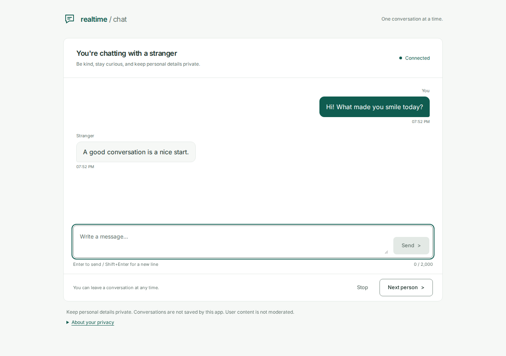
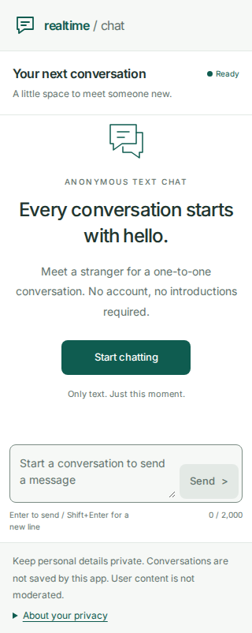

# Realtime Chat

Anonymous one-to-one text chat built with Go, Gin, Gorilla WebSocket, React, TypeScript, Vite, and Tailwind CSS. Visitors join a waiting queue, meet a stranger, and can leave or find someone new at any time.





## Run locally

Requirements: Go 1.26 or newer, Node 22.22.1, and npm. Development and tests were run with Go 1.26.4 and npm 9.2.0. Fonts are bundled locally. No database, cache, account, container, or external service is required.

```sh
make install
```

Start the backend in one terminal:

```sh
make backend
```

Start the frontend in another:

```sh
make frontend
```

Open **http://localhost:5173**. The backend binds to **127.0.0.1:8080**. Vite proxies `/v1`, `/health`, and `/ready`, including the WebSocket upgrade. Use `localhost` in the browser URL to match the allowed Origin. Stop each process with Ctrl+C; the backend closes active sockets and allows up to 10 seconds for shutdown.

The equivalent commands are `go mod download` and `go run .` from `backend/`, and `npm ci` and `npm run dev` from `frontend/`.

Defaults work without an `.env` file. See [.env.example](.env.example) for all backend settings and units. The application reads exported environment variables; it does not load `.env` files automatically. To customize settings in a shell:

```sh
export CHAT_ADDRESS=127.0.0.1:8080
export CHAT_ORIGINS=http://localhost:5173
make backend
```

For a different backend port, also export `CHAT_PROXY_TARGET=http://127.0.0.1:<port>` before starting Vite. This setting is used by the local dev server, not exposed as a browser secret.

If you change server message or frame limits, update the matching browser limits in `frontend/src/config/chat.ts` as well.

## Try a conversation

1. Open two tabs or browser windows and select **Start chatting** in each.
2. Send a message. Enter sends; Shift+Enter adds a line. Messages appear after the server echo, and the other tab can see typing status.
3. Select **Next person** and confirm. Open a third tab and start chatting to provide a new partner. The previous partner stays idle.
4. Select **Stop** and confirm, or close a partner's tab. Both clients clear the conversation. Use **Find someone** to start again.

Two previous partners will not immediately match again while their connections remain alive. Each tab is a separate anonymous session, subject to the default five-connection limit for the local IP. Waiting ends after two minutes. Reconnection returns to idle and never queues the visitor or resends messages automatically.

## What is implemented

- FIFO matchmaking, cancellation, Stop, Next, and partner departure notices.
- Server-generated rooms and messages, text validation, typing, and stale-room guards.
- Bounded queue, command channel, outbound buffers, connection quotas, and rate limits.
- Strict browser Origin checks, safe public errors, pong/write deadlines, and explicit WebSocket shutdown.
- Responsive chat UI, confirmation dialogs, keyboard and IME support, scroll handling, and bounded reconnect attempts.
- Backend behavior and race tests, frontend lifecycle tests, browser coverage, and a local load test runner.

## Privacy

The application has no database or saved transcript. Connections, matching, limits, and delivery buffers live in server RAM. Browser transcripts and drafts also stay in memory; the tab retains at most 200 messages and announces when earlier ones are removed. Leaving, changing partners, disconnecting, refreshing, or closing the page clears that conversation in the application.

The other person can copy or screenshot messages. User content is not moderated. The server reads text to relay it and processes IP addresses in memory for basic limits. Logs contain operational metadata, with no message text, drafts, raw session IDs, or full visitor IPs. Local HTTP/WS is unencrypted; this is not end-to-end encryption. The project makes no forensic RAM-erasure guarantee.

## Verification

```sh
make check

cd frontend
npx playwright install chromium
npm run test:browser
```

Playwright starts the real local backend and Vite when they are not already running. It uses three independent browser contexts and no database. The test server raises only handshake rate limits to accommodate browser lifecycle checks; ordinary connection, command, and payload limits remain in place. Default limits are tested separately in Go.

[Testing notes](docs/testing.md) describe coverage, measured results, and load-test setup. Load tests run separately from normal checks and require explicit loopback quota overrides.

On the documented local machine, 500 sockets exchanging one message per visitor every five seconds ran for 10 minutes with no errors or missing receipts and a p95 relay time of 2.098 ms. A synchronized five-message burst at 500 sockets exceeded the fixed command buffer and closed connections under the overload policy. See the report for the full traffic profile and limitations.

## Design

```text
Browser <-> Vite proxy <-> Gin handler -> ChatService -> Hub
                                                        |
                                               queue and rooms
                                                        |
                                               bounded buffers
                                                        |
                                                 socket writers
```

The handler owns admission and the upgrade. The service validates commands. One hub event loop owns queue and room mutations; each connection has one read pump and one write pump. The frontend connection hook owns session state, messages, timers, and actions. Logs use zerolog. See [architecture](docs/architecture.md) and the [WebSocket contract](docs/websocket.md).

This is a single-process local application. Multiple instances would split queues and need shared matchmaking coordination and transient routing between connection owners. That infrastructure, public hosting, CI/CD, and deployment are outside this version's scope.
